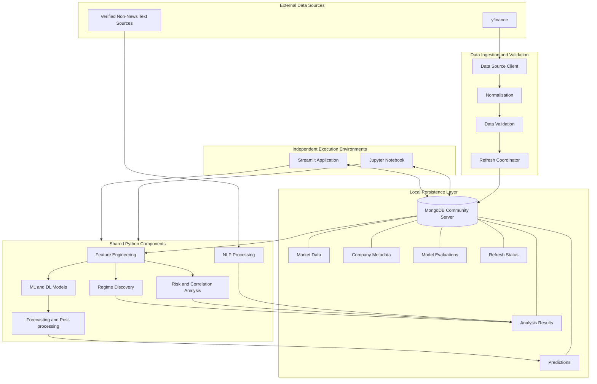
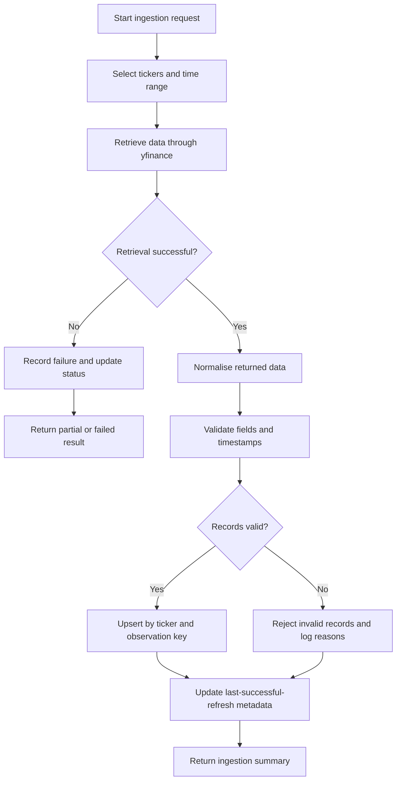
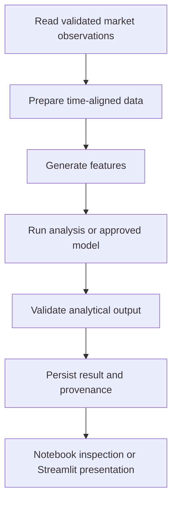
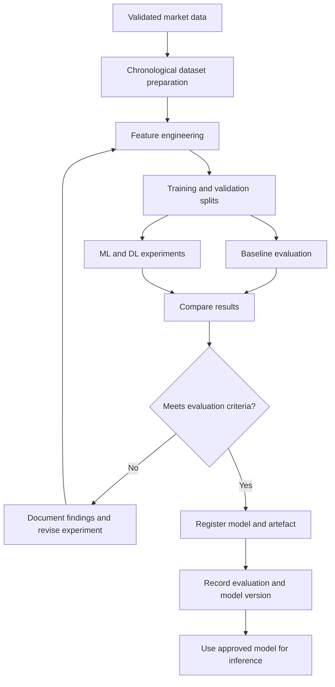
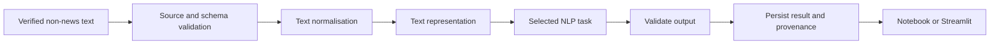

# System Architecture

**Project:** BeneathTheMarket  
**Document:** System Architecture  
**Status:** Proposed Architecture  
**Architecture Style:** Modular, data-centric application with shared local persistence  
**Primary Language:** Python  
**Primary Data Source:** `yfinance`  
**Database:** MongoDB Community Server (local instance)  
**Database Driver:** PyMongo  
**Research Environment:** Jupyter Notebook  
**Interactive Application:** Streamlit  

---

## 1. Purpose

This document defines the architecture of BeneathTheMarket, an AI-powered market intelligence platform designed to investigate market behaviour across established technology-focused and fintech companies.

It describes the system's major components, responsibilities, data flow, storage model, machine-learning lifecycle, NLP component, execution environments, operational requirements and testing strategy.

The architecture is intended to provide a consistent technical reference during implementation and maintenance. It establishes clear boundaries between data ingestion, processing, analysis, model development, prediction, persistence and presentation.

Implementation details may evolve as development progresses, but changes should preserve the core architectural principles defined in this document.

## 2. System Overview

BeneathTheMarket combines market-data engineering, exploratory data analysis, cross-company comparison, risk analysis, market-regime discovery, forecasting and bounded NLP-based analysis within one integrated project.

The system retrieves historical and recent market information programmatically through `yfinance`. Python components validate and transform the retrieved data before storing reusable records in a local MongoDB database.

Two independently executable environments consume the persisted information:

- **Jupyter Notebook:** Supports exploratory data analysis, feature engineering, experiments, model training, evaluation and research documentation.
- **Streamlit application:** Provides interactive market analysis, cross-company comparisons, risk assessment, regime intelligence, forecast inspection, NLP insights and data-refresh status.

MongoDB acts as the shared persistence layer. Neither execution environment requires the other to be running.

### 2.1 Architectural Objectives

The architecture must support:

1. Multi-company analysis across six technology-focused categories, targeting at least 30 validated publicly traded companies.
2. Programmatic market-data retrieval without requiring manually downloaded market datasets.
3. Historical analysis, recent-data inspection, forecasting and risk-related analysis.
4. Comparisons across individual companies, categories and broader market behaviour.
5. Evaluation of more than three machine-learning approaches and more than three deep-learning approaches, where suitable data and tasks permit.
6. A meaningful NLP component using appropriate non-news text, without introducing a news or news-sentiment pipeline.
7. Persistent storage of market observations, company metadata, analysis outputs, predictions, evaluation records and refresh status.
8. Independent operation of the notebook and Streamlit application.
9. Reliable data validation, duplicate prevention, refresh tracking and failure handling.
10. Reproducible experiments and transparent presentation of analytical limitations.

## 3. Architecture Principles

| Principle | Architectural application |
|---|---|
| Separation of concerns | Data retrieval, processing, modelling, persistence and presentation remain distinct responsibilities. |
| Independent execution | The notebook and Streamlit application start and operate independently. |
| Shared persistence | Both environments connect directly to the same local MongoDB instance through PyMongo. |
| Data provenance | Stored records retain relevant source, observation time, retrieval time and processing metadata. |
| Reproducibility | Experiments record data cut-offs, split dates, model versions and configuration where applicable. |
| Time-aware evaluation | Forecasting experiments respect chronological order and avoid future-data leakage. |
| Idempotent ingestion | Reprocessing the same company and observation date should not create duplicate daily records. |
| Graceful degradation | Missing or stale data must be communicated rather than silently presented as current. |
| Explicit configuration | Database connection details and operating settings are centralised. |
| No unnecessary infrastructure | The initial implementation uses a local MongoDB server without MongoDB Atlas or a mandatory cloud service. |
| Maintainability | Shared business logic is placed in reusable modules rather than duplicated across notebooks and application pages. |

## 4. High-Level Architecture

The system is organised into six logical layers:

1. **Data source layer:** External market information retrieved through `yfinance` and verified non-news text sources.
2. **Ingestion and validation layer:** Retrieval, normalisation, validation, deduplication and refresh coordination.
3. **Persistence layer:** Local MongoDB collections accessed through a shared database abstraction.
4. **Analytics and intelligence layer:** Feature engineering, exploratory analysis, risk calculations, regime discovery, ML/DL modelling and NLP processing.
5. **Execution layer:** Independent Jupyter Notebook and Streamlit application environments.
6. **Operational and quality layer:** Configuration, logging, monitoring, testing, model evaluation and data-quality controls.

### 4.1 Component Diagram



**Interpretation:** The diagram shows logical dependencies, not a requirement that every component run as a separate service. The initial implementation can remain a modular Python application with a local database.

## 5. Technology Stack

| Technology | Responsibility |
|---|---|
| Python | Primary implementation language for data processing, analysis and modelling. |
| `yfinance` | Programmatic retrieval of supported historical and recent market information. |
| Pandas and NumPy | Tabular processing, numerical calculations and feature preparation. |
| PyMongo | Database connectivity, queries, updates and persistence. |
| MongoDB Community Server | Local document-oriented storage. |
| Scikit-learn | Suitable ML workflows, preprocessing, baselines and evaluation utilities. |
| Deep-learning framework | Implementation and training of selected neural-network approaches. |
| NLP libraries | Text normalisation, representation, semantic similarity or other selected text-analysis tasks. |
| Jupyter Notebook | Research, EDA, experimentation and evaluation. |
| Streamlit | Interactive application and presentation layer. |
| Plotting libraries | Charts for market behaviour, risk, correlations and model evaluation. |
| Pytest | Automated testing of core components and integration behaviour. |
| Python logging | Operational events, warnings and failure diagnostics. |

Exact library versions should be recorded in the dependency specification and updated deliberately rather than changed without testing.

## 6. Component Responsibilities

### 6.1 Configuration Layer

**Location:** `config/`

The configuration layer centralises system settings so that notebooks, scripts and the Streamlit application use consistent values.

Responsibilities include:

- Local MongoDB connection URI.
- Database name and collection names.
- Company tickers and category mappings.
- Data retrieval periods and supported intervals.
- Refresh policies and retry settings.
- Forecast horizons and feature configuration.
- Model artefact paths and experiment settings.
- Logging levels and application defaults.

The application should not scatter hard-coded connection strings, ticker lists or operational settings throughout individual modules.

Sensitive values, if introduced later, must be supplied through environment variables rather than committed to source control.

### 6.2 Data Source Client

**Location:** `src/data_pipeline/yfinance_client.py`

The data source client encapsulates interaction with `yfinance`.

Responsibilities:

- Request supported historical or recent observations for configured tickers.
- Handle company-specific retrieval failures.
- Validate that returned data has the expected structure.
- Preserve ticker identity and observation timestamps.
- Distinguish empty responses from successful retrievals.
- Report retrieval errors to the ingestion workflow.
- Respect source limitations, available history and supported intervals.

This component should not contain presentation logic or directly construct Streamlit widgets.

The project must not assume that every ticker, interval or requested time range is always available.

### 6.3 Normalisation and Validation

**Location:** `src/data_pipeline/normalizer.py` and `src/data_pipeline/validators.py`

The normalisation component converts source responses into a consistent internal representation.

Validation checks should cover:

- Required fields and expected data types.
- Valid ticker identifiers.
- Valid observation dates.
- Missing or non-finite numerical values.
- Invalid or inconsistent price and volume fields.
- Duplicate company-date observations.
- Unexpected column names or index structures.
- Empty or incomplete responses.
- Chronological ordering.

Validation must not silently fabricate missing market observations. Records that fail essential checks should be rejected or quarantined according to the defined validation policy, with the reason logged.

### 6.4 Ingestion and Refresh Coordination

**Location:** `src/data_pipeline/ingestion.py` and `src/data_pipeline/refresh.py`

The ingestion workflow coordinates retrieval, validation and persistence.

Its responsibilities include:

1. Determine which tickers and time ranges require retrieval.
2. Request data from the source client.
3. Normalise and validate returned observations.
4. Deduplicate records using the defined database key.
5. Upsert valid records into MongoDB.
6. Update refresh status and data-quality information.
7. Record failures without discarding successful results for unrelated tickers.
8. Expose a clear result to the caller.

The refresh coordinator must distinguish an attempted refresh from a successful refresh. A failed retrieval must not update the last-successful-refresh timestamp as if fresh data had been stored.

### 6.5 Database Access Layer

**Location:** `src/db/`

The database layer provides a consistent interface to MongoDB.

It should contain:

- Connection initialisation and health checks.
- Collection access and index creation.
- Insert, query and update operations.
- Duplicate-safe upsert functions.
- Query filters for ticker, category and observation period.
- Persistence functions for analyses and predictions.
- Refresh-status updates.
- Appropriate error handling for database unavailability.

Higher-level modules should use these functions rather than duplicating raw database queries across notebooks and Streamlit pages.

Database access should remain explicit and easy to test.

### 6.6 Feature Engineering

**Location:** `src/features/`

Feature engineering converts validated market observations into analytical variables.

Possible features include:

- Daily returns and multi-period returns.
- Rolling volatility.
- Moving averages and price-relative indicators.
- Drawdown and recovery characteristics.
- Trading-volume changes where data is available.
- Cross-company correlations.
- Category-level summaries.
- Lagged features for forecasting.
- Candidate features for market-regime analysis.

Every feature must have a documented definition, look-back period and availability requirement.

Features used for prediction at time \(t\) must be constructed using information available at or before the prediction cut-off. Future observations must not influence training features.

### 6.7 Analysis Layer

**Location:** `src/analysis/`

The analysis layer contains reusable analytical procedures for:

- Exploratory data analysis.
- Company and category comparisons.
- Correlation and co-movement analysis.
- Drawdown and risk-related analysis.
- Regime discovery.
- Summary statistics and trend inspection.

Analysis functions should accept data or structured inputs and return documented results. Charts, Streamlit controls and notebook display formatting should remain outside core analytical calculations wherever practical.

### 6.8 Modelling Layer

**Location:** `src/models/`

The modelling layer manages baseline approaches, ML/DL experiments, training, evaluation and model registration.

Responsibilities include:

- Defining training and prediction interfaces.
- Preparing model-specific input data.
- Training supported approaches.
- Saving and loading validated model artefacts.
- Recording experiment configuration.
- Comparing results against appropriate baselines.
- Tracking model versions and evaluation outcomes.
- Preventing unvalidated models from being presented as approved models.

The project target is to compare more than three ML approaches and more than three DL approaches. The final selection should depend on the task, data sufficiency, computational feasibility and evaluation results.

The architecture does not require a separate application page for each model.

### 6.9 Forecasting Layer

**Location:** `src/forecasting/`

The forecasting layer coordinates feature preparation, model inference and forecast post-processing.

It should:

- Identify the intended company and forecast horizon.
- Check the availability and freshness of required input data.
- Load the appropriate registered model.
- Apply the same preprocessing expected by that model.
- Generate forecast outputs.
- Record the model version and input-data cut-off.
- Apply output validation.
- Persist results where appropriate.
- Communicate unavailable or failed predictions clearly.

Forecasts are analytical estimates, not guarantees of future market performance or recommendations to buy or sell securities.

### 6.10 NLP Layer

**Location:** `src/nlp/`

The NLP component analyses verified non-news textual information, such as company descriptions or sector descriptions, when a reliable source is available.

Potential responsibilities include:

- Retrieving or loading approved text inputs.
- Recording source provenance and retrieval dates.
- Text cleaning and normalisation.
- Generating text representations.
- Analysing semantic similarity between companies or categories.
- Storing reusable NLP results.

The component must not depend on news articles, news feeds or news-sentiment data.

The exact NLP task and its data source must be validated during the feasibility phase. If an appropriate source cannot be verified, the implementation should narrow or defer that component rather than imply that unsupported text data exists.

### 6.11 Streamlit Presentation Layer

**Location:** `app/`

The Streamlit application is the interactive presentation environment. It should call shared services and database functions instead of reimplementing ingestion, feature engineering or model logic inside page scripts.

Proposed sections:

| Section | Primary responsibility |
|---|---|
| Market Overview | Summarise recent market behaviour and data coverage. |
| Cross-Company Comparison | Compare companies and categories using common analytical measures. |
| Regime Intelligence | Present identified market conditions and associated patterns. |
| Forecasting | Display model forecasts, horizons, cut-off times and relevant evaluation context. |
| Risk Analysis | Explore volatility, drawdowns, correlation and other supported risk measures. |
| NLP Insights | Present text-based similarity or other validated non-news NLP outputs. |
| Data Status | Show retrieval outcomes, latest successful updates, data coverage and failures. |

Filters and input controls should affect the displayed results. Pages must communicate empty states, stale information and unavailable model outputs clearly.

The app should not require notebook execution to load its core functionality.

### 6.12 Notebook Research Layer

**Location:** `notebooks/`

The notebook environment is responsible for research and experimentation, including:

- Ticker feasibility and data-source validation.
- Data retrieval and exploratory data analysis.
- Feature engineering and inspection.
- Regime-discovery experiments.
- ML/DL training and comparison.
- NLP experiments.
- Chronological evaluation.
- Documentation of findings and limitations.

Notebooks may import shared project modules, but should not rely on the Streamlit runtime, browser session state or UI callbacks.

The notebook should be able to connect to MongoDB directly and should document any required setup or execution order.

## 7. Data Flow

### 7.1 Market Data Ingestion



A retrieval request can partially succeed when some tickers fail. The system should preserve valid observations and record failures separately rather than treating the entire batch as successful.

### 7.2 Analytics and Prediction



The same shared processing functions should be used where appropriate by both environments to reduce inconsistent calculations.

## 8. Data Source and Refresh Architecture

### 8.1 Data Source Policy

The primary market-data source is `yfinance`.

The system should retrieve supported information programmatically. A manually downloaded market dataset is not a required input.

Source data availability, historical coverage, interval restrictions, ticker changes and retrieval failures must be treated as operational constraints.

The project must not assume that `yfinance` guarantees a particular service level, continuous availability or a universal hourly history for every ticker.

### 8.2 Refresh Policy

The proposed policy separates recent-data refresh attempts from daily persistent-record maintenance.

| Operation | Intended behaviour |
|---|---|
| Recent-data refresh | Attempt an hourly refresh when the scheduler or refresh process is running and the source supports the requested data. |
| Daily persistence update | Update stored daily observations at least once per scheduled daily cycle, subject to source availability and validation. |
| Historical backfill | Retrieve required historical observations during initial setup or a deliberate backfill operation. |
| Manual refresh | Allow an authorised local user to initiate a refresh where the application exposes that capability. |
| Failure recovery | Retry transient failures within configured limits and preserve the previous valid records. |
| Refresh reporting | Record attempt time, successful completion time, result, affected tickers and error summaries. |

Hourly refresh attempts and daily updates are distinct operations. The implementation must define which intervals are available and whether an hourly observation is genuinely new before persisting it.

A scheduled task cannot run while its host process or machine is stopped. The application must not claim that background updates continue when the scheduler is inactive.

### 8.3 Scheduling and Idempotency

Scheduling should be implemented through the project's refresh scripts and an appropriate local scheduler or explicitly managed long-running process.

Recommended scripts include:

- `scripts/hourly_refresh.py`
- `scripts/daily_update.py`
- `scripts/backfill_market_data.py`

The refresh mechanism should:

- Prevent overlapping runs for the same operation where practical.
- Use consistent timestamps and date handling.
- Upsert observations rather than blindly inserting duplicates.
- Avoid overwriting valid observations with empty or invalid responses.
- Record unsuccessful attempts and retry outcomes.
- Avoid treating an attempted refresh as a successful refresh.
- Make repeated execution safe.

The scheduler is an operational dependency, not an implicit feature of Streamlit. Opening the application must not be the only mechanism responsible for data freshness.

## 9. MongoDB Architecture

### 9.1 Deployment Model

The system uses **MongoDB Community Server running locally**, accessed through PyMongo.

Default development URI:

`mongodb://localhost:27017`

The database name should be defined centrally in configuration. MongoDB Atlas and other cloud-hosted MongoDB deployments are outside the proposed architecture.

The MongoDB service must be installed and running before database-dependent workflows can execute.

### 9.2 Collection Design

The following collections are proposed.

| Collection | Purpose | Suggested logical key |
|---|---|---|
| `market_data` | Validated daily market observations. | `ticker + date` |
| `company_metadata` | Company identity, category and descriptive metadata. | `ticker` |
| `analysis_results` | Persisted analytical summaries and derived outputs. | `analysis_id` |
| `predictions` | Forecast outputs and prediction provenance. | `prediction_id` |
| `model_evaluations` | Experiment results and model-comparison records. | `evaluation_id` |
| `refresh_status` | Refresh attempts, outcomes and data-freshness metadata. | `job_id` or a defined job key |

The logical keys above must be enforced using appropriate unique indexes where their semantics permit it.

### 9.3 Market Data Document

A daily market-data document may contain fields such as:

```json
{
  "ticker": "MSFT",
  "date": "2026-10-09",
  "open": 0.0,
  "high": 0.0,
  "low": 0.0,
  "close": 0.0,
  "adjusted_close": 0.0,
  "volume": 0,
  "source": "yfinance",
  "retrieved_at": "UTC datetime",
  "updated_at": "UTC datetime",
  "schema_version": 1
}
```

**Illustrative schema only:** Numeric values and dates must come from actual validated source data. The example does not represent a real market observation.

The implementation must decide consistently whether `close` represents the unadjusted close and how adjusted prices are handled. It must not mix adjusted and unadjusted series without documenting the distinction.

Dates used as daily observation keys should follow a consistent market-date convention. Retrieval timestamps should use timezone-aware datetimes, preferably stored in UTC.

### 9.4 Prediction Document

A prediction record should preserve enough information to interpret and reproduce the output.

Suggested fields:

- Unique prediction identifier.
- Ticker or set of tickers.
- Prediction target and horizon.
- Prediction generation timestamp.
- Latest input observation date or data cut-off.
- Model name and model version.
- Input-feature or preprocessing version.
- Forecast output.
- Relevant confidence or uncertainty information, if the model supports it.
- Associated evaluation reference.
- Validation status and applicable warnings.

A prediction without its horizon, input cut-off and model identity is insufficiently traceable for meaningful comparison.

### 9.5 Model Evaluation Document

Evaluation records should include:

- Experiment and evaluation identifiers.
- Model family and version.
- Prediction target.
- Training and validation date ranges.
- Held-out test period.
- Data cut-off and feature configuration.
- Evaluation results appropriate to the task.
- Baseline comparison.
- Relevant per-company and category-level results.
- Training configuration and reproducibility metadata.
- Notes on failed runs or limitations.

The exact evaluation fields depend on the model task. Classification, forecasting and unsupervised regime discovery do not share one universal evaluation schema.

### 9.6 Refresh Status Document

Refresh records should distinguish:

- Job identifier and operation type.
- Start and completion timestamps.
- Attempt status.
- Tickers or records processed.
- Successful, failed and skipped items.
- Last successful refresh timestamp.
- Error summary.
- Retry count, where applicable.
- Source and refresh-policy version.

This collection provides the basis for the Data Status section and for diagnosing stale data.

### 9.7 Indexing and Query Strategy

Indexes should be created according to actual query patterns.

Recommended starting points:

- Unique compound index on `market_data` using `ticker` and `date`.
- Unique index on `company_metadata.ticker`.
- Indexes for prediction lookup by ticker, horizon and generation time.
- Indexes for evaluation lookup by model, experiment and evaluation date.
- Indexes for refresh status by job type and start time.
- Indexes for analysis records by analysis type, ticker or category, where required.

Index definitions should be implemented centrally and verified through the database initialisation script.

Avoid creating indexes speculatively on every field. Additional indexes consume storage and increase write overhead.

### 9.8 Database Access Rules

- Use PyMongo for all database access.
- Keep connection creation in the database connection module.
- Reuse clients appropriately rather than creating unnecessary connections for every query.
- Apply explicit query filters and projections.
- Use upserts for records with a defined stable identity.
- Validate documents before writing them.
- Handle connection failures and operation timeouts.
- Keep large derived arrays or model artefacts out of documents unless their size and usage justify it.
- Store model artefacts in the configured model directory and record their references in MongoDB.
- Do not assume that files stored on disk are automatically persisted in MongoDB.

## 10. Independence of Notebook and Streamlit

Independent execution is a core architectural requirement.

### 10.1 Jupyter Notebook

The notebook must:

- Start without launching Streamlit.
- Establish its own MongoDB connection.
- Read persisted market data and metadata.
- Execute its own research and modelling workflow.
- Save approved outputs through shared database functions.
- Operate without depending on Streamlit session state or page modules.

### 10.2 Streamlit Application

The Streamlit application must:

- Start without running a notebook.
- Establish its own MongoDB connection through the shared database layer.
- Read available market data, analysis outputs and predictions.
- Invoke supported shared processing or inference functions.
- Display clear database and model-availability states.
- Avoid depending on notebook execution order.

### 10.3 Shared Dependencies

Both environments may import common modules from `config/` and `src/`.

The shared codebase contains reusable logic; it does not create a runtime dependency between the two environments.

The notebook and application should be tested separately, followed by integration tests confirming that they can read and write the expected records in the same local database.

## 11. Machine-Learning and Deep-Learning Architecture

### 11.1 Model Development Lifecycle



### 11.2 Data Preparation

Training data must be constructed from chronologically ordered observations.

Preparation should include:

- Consistent feature definitions.
- Explicit prediction targets.
- Documented look-back and forecast horizons.
- Missing-value handling that does not use future information.
- Training-only fitting of learned preprocessing steps.
- Chronological training, validation and test partitions.
- Clear separation between training and inference preprocessing.

Random shuffling is inappropriate when it causes future observations to leak into earlier forecasting examples.

### 11.3 Model Comparison

The system should compare more than three ML approaches and more than three DL approaches, subject to feasibility.

The model registry should identify each experiment by task, configuration, training period and version.

Comparison should include:

- Appropriate baseline performance.
- Suitable task-specific evaluation measures.
- Held-out chronological performance.
- Per-company results.
- Category-level summaries.
- Computational requirements and training time where useful.
- Stability across different time periods.
- Failure cases and limitations.

A larger number of models does not automatically indicate better quality. Model selection should be based on evidence, suitability and reproducibility.

### 11.4 Model Artefacts

Model files should be stored under the configured model directory, separated by model family where appropriate.

The database should store metadata and references to artefacts rather than duplicate large binary objects unnecessarily.

Each registered model should identify:

- Model family and version.
- Training data cut-off.
- Feature configuration.
- Preprocessing requirements.
- Supported task and horizon.
- Evaluation record.
- Artefact location.
- Registration status.

Only artefacts that can be loaded and used with the documented input schema should be marked available for inference.

## 12. Forecasting and Evaluation

### 12.1 Forecasting Contract

Every forecast request should define:

1. Company or company set.
2. Target variable.
3. Forecast horizon.
4. Required input history.
5. Model version.
6. Latest permitted input observation.
7. Output format and validation requirements.

The system must not imply that a forecast describes the current market if the underlying observations are stale.

### 12.2 Chronological Validation

The evaluation process should use chronological splits or walk-forward evaluation where appropriate.

The held-out test period must not be used for feature selection, hyperparameter tuning or repeated model selection.

The final test results should be reported separately from training and validation results.

### 12.3 Evaluation Categories

Evaluation should be tailored to each task:

- **Forecasting:** Compare predictions against observed outcomes and suitable baseline forecasts.
- **Classification:** Assess class-sensitive performance and inspect confusion patterns.
- **Regime discovery:** Examine separation, stability, regime sizes and interpretability.
- **Cross-company analysis:** Compare results by ticker and category, not only in aggregate.
- **NLP:** Evaluate the selected text task using appropriate task-specific checks and verified source provenance.

No evaluation measure should be presented as meaningful without defining the target, test period and interpretation.

### 12.4 Prediction History

Persisted predictions should be treated as historical outputs, not automatically as verified outcomes.

Where actual future observations become available, the system may calculate realised errors and store the result as a separate evaluation or forecast-verification record.

This separation prevents predicted values from being confused with observed market data.

## 13. NLP Architecture

The NLP subsystem is intentionally bounded and independent of news processing.

### 13.1 Input Policy

Permitted inputs must be verified, relevant non-news text, such as suitable company descriptions or sector descriptions.

The implementation should document:

- Source identity.
- Source URL or other reference where appropriate.
- Retrieval or verification date.
- Text version or content hash where useful.
- Processing method.
- Limitations and usage permissions.

The existence and suitability of the source must be confirmed before the NLP pipeline is finalised.

### 13.2 Processing Flow



Text representations may include numerical embeddings or other suitable representations, depending on the chosen task.

NLP outputs should not be interpreted as financial signals unless a separate, defensible evaluation establishes that relationship. Company-description similarity alone does not establish predictive value.

## 14. Streamlit Application Architecture

### 14.1 Request Flow

The typical application request follows this path:

1. A user selects a company, category, time period or analysis option.
2. The relevant page validates the selection.
3. The page calls a service function.
4. The service retrieves the required records through the shared database layer.
5. If necessary, a supported analytical or inference function is invoked.
6. The result is checked and formatted for presentation.
7. The page displays the result, its data cut-off and any relevant warnings.

### 14.2 Presentation Responsibilities

Streamlit pages are responsible for:

- User input and filters.
- Result selection and display.
- Chart and table presentation.
- User-readable error and status messages.
- Contextual explanations of forecasts and analytical results.

They should not independently define conflicting feature calculations or duplicate database schemas.

### 14.3 Caching and Freshness

Caching may be used for expensive or repeatedly requested operations, provided that cached data has a clear invalidation policy.

The application must distinguish:

- Cached display data.
- Latest stored market observations.
- Last successful source refresh.
- Latest prediction generation time.

A cache timestamp must never be presented as proof that the source has recently refreshed.

### 14.4 Failure States

The application should handle at least the following conditions:

- MongoDB unavailable.
- No market records available.
- A selected ticker has insufficient history.
- Data is stale.
- A refresh has partially failed.
- A model artefact is missing or incompatible.
- A forecast cannot be generated.
- NLP source data is unavailable.
- An analysis returns an empty result.

Where appropriate, the application should continue to display valid stored information while explaining that a new refresh or computation failed.

## 15. Error Handling and Reliability

Errors should be handled at the component boundary where they can be interpreted and reported correctly.

| Failure | Expected handling |
|---|---|
| Source request failure | Record the failure, retry when appropriate and preserve existing valid data. |
| Invalid source response | Reject invalid records and log validation reasons. |
| Missing ticker history | Mark the ticker unavailable or insufficiently covered for the requested task. |
| Duplicate observation | Prevent duplicates through unique keys and upsert logic. |
| MongoDB unavailable | Report the dependency failure and stop database-dependent operations safely. |
| Model loading failure | Mark the model unavailable and avoid returning an unverified result. |
| Invalid forecast output | Reject the output and record the failure. |
| Partial batch failure | Preserve successful results and report failed tickers separately. |
| Stale data | Display the last successful refresh time and a freshness warning. |
| Missing NLP source | Disable or clearly mark the NLP feature as unavailable. |

Retries should be bounded and should apply primarily to transient failures. Permanent validation errors should not be retried indefinitely.

Logging must provide enough context for diagnosis without exposing credentials or other sensitive configuration.

## 16. Security and Configuration

### 16.1 Local Database Security

The initial design uses a local MongoDB Community Server.

The database URI should be centrally configured, with `mongodb://localhost:27017` as the local development default.

MongoDB must not be unnecessarily exposed to a public network. Authentication and access controls should be configured appropriately for the deployment environment.

If authentication is enabled, credentials should be supplied through environment variables or another appropriate local secret mechanism.

### 16.2 Environment Configuration

The `.env.example` file may document non-secret configuration keys, such as:

```dotenv
MONGODB_URI=mongodb://localhost:27017
MONGODB_DATABASE=beneath_the_market
LOG_LEVEL=INFO
```

These are example development defaults. Actual names must remain consistent with `config/settings.py`.

A local `.env` file containing credentials must not be committed to the repository.

### 16.3 Repository Hygiene

The repository should exclude:

- Real credentials and private configuration.
- Unnecessary temporary files.
- Large, reproducible intermediate datasets where not required.
- Unintended notebook outputs containing sensitive information.
- Untracked model artefacts that are not intended for distribution.
- Runtime logs and caches.

Dependencies should be declared and reproducible through the project's dependency-management approach.

### 16.4 Model Artefact Safety

Model loading must be restricted to trusted artefacts generated or deliberately approved for the project. Deserialisation formats that can execute arbitrary code must not be loaded from untrusted sources.

## 17. Performance and Scalability

The initial target is a local, intermediate-level project covering at least 30 validated companies.

Performance should be improved through measured, practical steps:

- Fetch data in efficient batches when supported.
- Avoid repeated retrieval of unchanged historical periods.
- Use database indexes aligned with common queries.
- Limit database projections to required fields.
- Reuse database clients appropriately.
- Cache expensive analytical results with explicit invalidation.
- Separate long-running training experiments from ordinary page rendering.
- Avoid retraining all models on every user interaction.
- Store reusable model artefacts and evaluation results.
- Process company subsets when a full-universe operation is unnecessary.

The first implementation does not require microservices, distributed orchestration or a cloud database. Such infrastructure should be considered only if measured needs justify the added complexity.

## 18. Observability and Logging

The project should use structured, consistent logging across scripts, notebook utilities and application services.

Important events include:

- Application or script startup.
- MongoDB connection success or failure.
- Source retrieval start and completion.
- Per-ticker ingestion results.
- Validation failures.
- Database upsert counts.
- Refresh completion and failure.
- Model training and evaluation completion.
- Model registration and loading.
- Prediction generation.
- Unhandled exceptions.

Logs should include timestamps and meaningful operation identifiers. Where applicable, they should identify the ticker, job or experiment involved.

The Data Status page should derive its freshness information from persisted refresh metadata rather than infer it from the time the Streamlit page was opened.

## 19. Testing Strategy

Testing must cover individual modules, database integration and independent execution.

### 19.1 Unit Tests

Test individual functions for:

- Data normalisation.
- Validation rules.
- Feature calculations.
- Chronological dataset preparation.
- Duplicate-key construction.
- Forecast post-processing.
- Evaluation calculations.
- NLP preprocessing.
- Error handling.

### 19.2 Integration Tests

Test:

- Local MongoDB connectivity.
- Collection and index initialisation.
- Market-data upsert behaviour.
- Prediction and evaluation persistence.
- Refresh-status updates.
- Data retrieval filters.
- Shared configuration.
- Model loading and inference contracts.

Tests should use an isolated test database or controlled fixtures. They must not modify production project records unintentionally.

### 19.3 Source Client Tests

External data retrieval tests should account for network failures, source changes and temporary unavailability.

Where possible, test data transformations and failure handling with controlled responses. Live-source tests should be identified separately because they depend on external service behaviour.

### 19.4 Independence Tests

Verify that:

1. The notebook can connect to MongoDB and read required data without launching Streamlit.
2. The Streamlit application starts without executing the notebook.
3. Both environments use the same documented database configuration.
4. A record written through one environment can be read by the other.
5. Neither environment imports the other as a runtime dependency.

### 19.5 Model Evaluation Tests

Verify that:

- Time-based splits preserve chronological order.
- Features do not unintentionally use future observations.
- Baselines are included.
- Test-period observations do not enter training.
- Model metadata matches the evaluated artefact.
- Prediction records include their horizon and data cut-off.

## 20. Deployment and Execution Model

### 20.1 Local Development Environment

The intended deployment is a local development environment with:

- Python and project dependencies installed.
- MongoDB Community Server running locally.
- Project configuration available.
- Required market data retrieved through `yfinance`.
- Model artefacts available when inference is required.
- The notebook and Streamlit app started independently.

### 20.2 Execution Modes

**Research mode**

The developer starts Jupyter Notebook, performs research or training, evaluates results and persists relevant outputs.

**Application mode**

The developer starts Streamlit, which reads stored data and approved artefacts and provides interactive analysis.

**Refresh mode**

A refresh script retrieves and validates new market data and records the outcome in MongoDB.

**Backfill mode**

A controlled operation retrieves required historical observations and persists them without duplicating existing daily records.

**Training mode**

A dedicated script or notebook trains candidate models, evaluates them and registers suitable artefacts.

### 20.3 Operational Dependencies

The local MongoDB service is required for database-backed functionality.

External source access is required for new `yfinance` retrievals and any live retrieval of approved NLP inputs. Previously stored valid records may remain available when the external source is unavailable, subject to database connectivity.

Background refreshes require the configured scheduler or refresh process to be active.

## 21. Proposed Repository Mapping

The architecture maps to the following major directories:

| Directory | Architectural responsibility |
|---|---|
| `config/` | Central configuration, constants and ticker definitions. |
| `data/` | Local processed data and model artefacts where required; generated files must be managed deliberately. |
| `src/db/` | MongoDB connections, collection access and persistence operations. |
| `src/data_pipeline/` | Retrieval, normalisation, validation, ingestion and refresh. |
| `src/features/` | Reusable feature calculations. |
| `src/analysis/` | EDA, correlation, drawdown and regime analysis. |
| `src/models/` | Baselines, ML/DL training, evaluation and model registry. |
| `src/nlp/` | Non-news text processing and similarity analysis. |
| `src/forecasting/` | Inference coordination and output post-processing. |
| `src/utils/` | Logging, time handling and shared utility functions. |
| `notebooks/` | Research, EDA, experimentation and evaluation. |
| `app/` | Streamlit entry point, pages, components and services. |
| `scripts/` | Database initialisation, refresh, backfill and training operations. |
| `tests/` | Unit, integration and independence tests. |
| `docs/` | Architecture, data dictionary, evaluation protocol and NLP source documentation. |
| `reports/` | Selected generated research reports and documented results. |

The repository structure is an implementation mapping, not a requirement that every module become a separate process or service.

## 22. Key Architecture Decisions

### ADR-01: Local MongoDB

**Decision:** Use MongoDB Community Server on the local machine through PyMongo.

**Reasoning:** The project requires persistent, shared data access without a mandatory cloud database.

**Consequence:** MongoDB must be installed, configured and running locally for database-dependent features.

### ADR-02: Independent Research and Application Environments

**Decision:** Keep Jupyter Notebook and Streamlit independently executable.

**Reasoning:** Research workflows and interactive application usage have different execution requirements.

**Consequence:** Shared business logic must live in reusable modules, with MongoDB providing shared persistence rather than runtime coupling.

### ADR-03: Programmatic Market-Data Retrieval

**Decision:** Use `yfinance` for supported market-data retrieval instead of requiring manually downloaded market datasets.

**Reasoning:** The project is intended to work with programmatically retrieved historical and recent observations.

**Consequence:** Data availability and refresh success depend on the external source and its limitations.

### ADR-04: Purpose-Oriented Application Sections

**Decision:** Organise Streamlit around analytical tasks rather than creating one page for each model.

**Reasoning:** The application should help users investigate market behaviour, risk, forecasts and company relationships.

**Consequence:** Multiple models may support the same page or analytical workflow.

### ADR-05: Chronological Evaluation

**Decision:** Use time-aware validation for forecasting and other time-dependent tasks.

**Reasoning:** Random splits or leakage can produce misleading performance estimates.

**Consequence:** Data preparation, feature engineering and model selection must respect the temporal boundaries of each experiment.

### ADR-06: Bounded Non-News NLP

**Decision:** Restrict NLP inputs to verified non-news text.

**Reasoning:** The project explicitly excludes news and news-sentiment analysis.

**Consequence:** The source and intended NLP task must be verified before the component is treated as complete.

## 23. Risks and Mitigations

| Risk | Mitigation |
|---|---|
| External source unavailable | Preserve valid stored observations, record failures and retry within limits. |
| Inconsistent ticker coverage | Validate the company universe before modelling and track coverage by ticker. |
| Stale displayed information | Expose last-successful-refresh timestamps and freshness warnings. |
| Duplicate daily records | Enforce stable keys and use upserts. |
| Future-data leakage | Use chronological splits and review feature-generation boundaries. |
| Unreliable forecasts | Compare against baselines, evaluate on held-out periods and explain limitations. |
| Inconsistent calculations | Share reusable processing modules across notebook and application. |
| Database service unavailable | Report the failure and disable dependent operations safely. |
| NLP source cannot be verified | Document the limitation and narrow or defer the component. |
| Excessive computational cost | Use measured resource limits and avoid retraining during routine page rendering. |
| Model artefact mismatch | Record model and preprocessing versions and validate inference compatibility. |
| Scheduler not running | Surface the last successful update and document scheduler requirements. |

## 24. Limitations and Scope Boundaries

The architecture does not guarantee:

- Continuous market-data availability.
- An hourly update when the refresh process is inactive.
- Uniform historical intervals or coverage across every ticker.
- Accurate forecasts or profitable investment outcomes.
- Stable model performance across all market regimes.
- That company-description similarity predicts stock-price movement.
- That every candidate company will remain eligible after data feasibility checks.

The initial implementation is not designed as a real-time exchange feed, brokerage system, automated trading engine or investment-advisory service.

Its purpose is analytical research, forecasting experimentation and interactive market intelligence.

## 25. Architecture Acceptance Criteria

The architecture is considered implemented to an acceptable baseline when the following conditions are verified:

- [ ] MongoDB Community Server runs locally and is accessed through PyMongo.
- [ ] No MongoDB Atlas dependency is required.
- [ ] Market observations can be retrieved programmatically through `yfinance`.
- [ ] At least 30 companies have been validated for the selected project scope, subject to source availability.
- [ ] Market-data records are validated and stored without duplicate daily keys.
- [ ] Refresh attempts, failures and successful updates are recorded distinctly.
- [ ] Notebook and Streamlit execute independently.
- [ ] Both environments can read and write the intended shared MongoDB records.
- [ ] EDA, feature engineering and cross-company analysis are reproducible.
- [ ] More than three ML approaches and more than three DL approaches are evaluated where feasibility permits.
- [ ] Evaluation uses appropriate baselines and time-aware validation for forecasting.
- [ ] NLP processing uses a documented, verified non-news source.
- [ ] Prediction records identify the target, horizon, model version and input cut-off.
- [ ] Streamlit provides the intended analytical sections and meaningful status information.
- [ ] Database failures, source failures and unavailable models are handled explicitly.
- [ ] Automated tests cover core processing, persistence and environment independence.
- [ ] Configuration and repository hygiene prevent accidental credential exposure.

## 26. Related Documentation

This document should be maintained alongside:

- `README.md` — project overview, setup and usage instructions.
- `docs/data_dictionary.md` — field definitions, types, keys and collection schemas.
- `docs/evaluation_protocol.md` — targets, split strategy, baselines, evaluation measures and reporting rules.
- `docs/nlp_source_notes.md` — verified non-news text sources, provenance, permissions and NLP task boundaries.

The architecture describes the overall system and its component relationships. The related documents provide more detailed operational and methodological specifications.

## 27. Maintenance Policy

This document should be updated whenever a material architectural decision changes, including database design, component responsibilities, data-source policy, refresh strategy, execution independence, model lifecycle or deployment assumptions.

Changes should remain consistent with the actual implementation. Proposed components must not be described as operational until implemented and tested.

Where an architectural decision changes, the rationale and consequences should be documented so that future development remains traceable.

---

**End of Architecture Document**